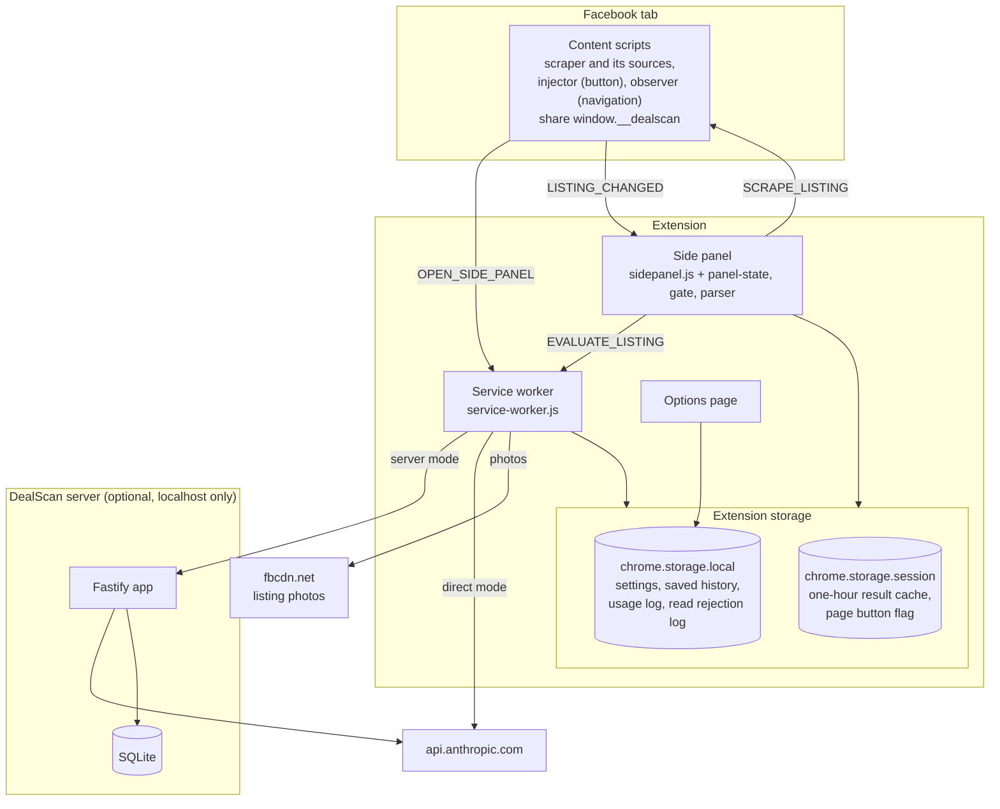
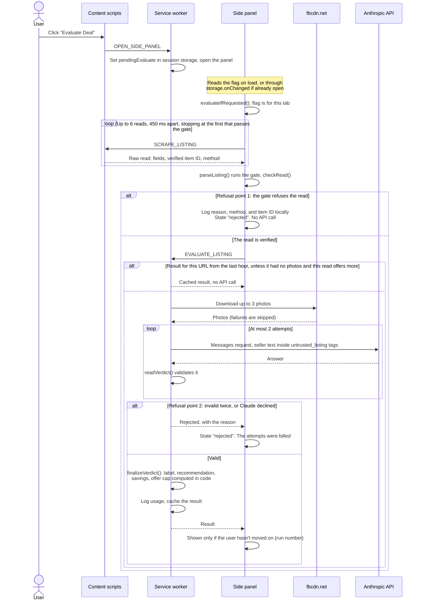
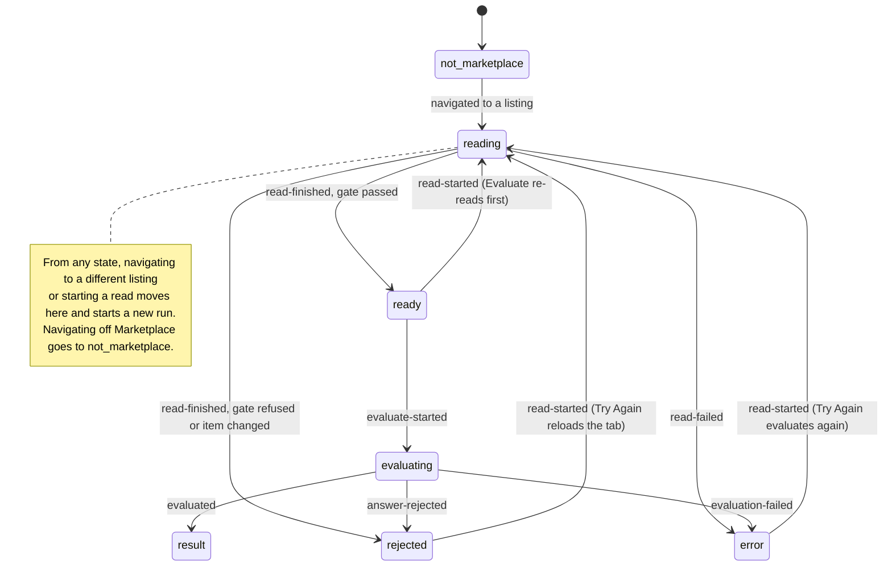
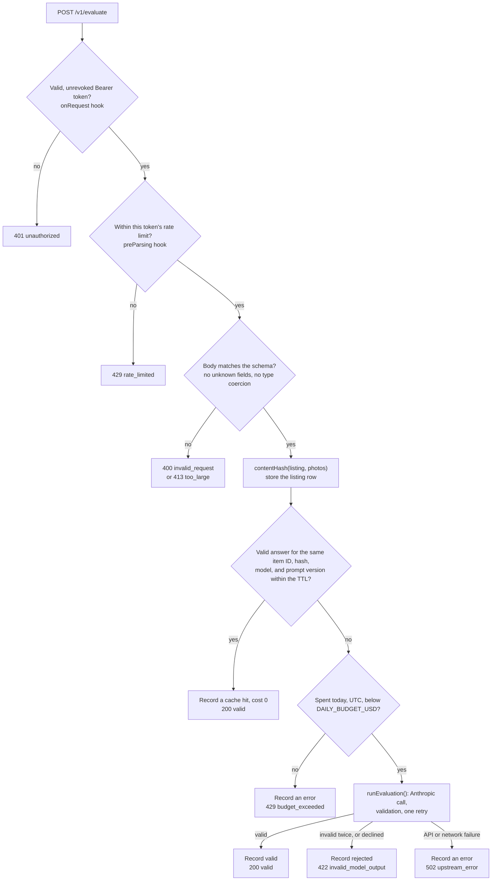
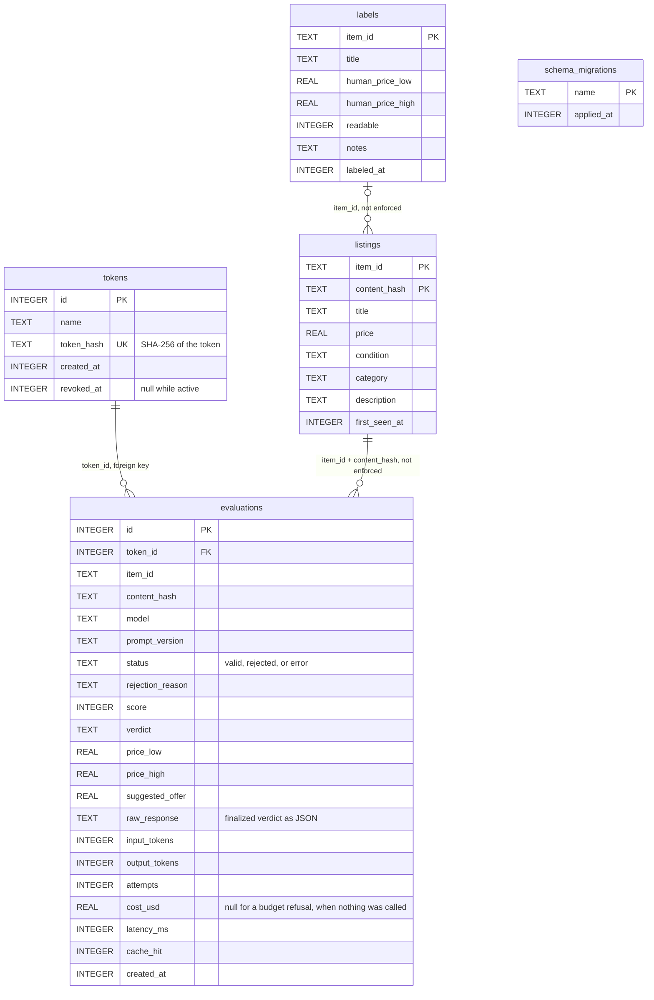

# Architecture

DealScan reads a Facebook Marketplace listing, asks Claude to evaluate it, and shows the result in Chrome's side panel. Two things in that path can be wrong: the page read and the model's answer. The design puts one explicit check on each, and refuses rather than guesses when a check fails.

For each file's role see [CODEMAP.md](CODEMAP.md). For why it's built this way see [DECISIONS.md](DECISIONS.md).

## System overview

The content scripts only read the page and never make network calls. The side panel asks them for a read, decides whether it can be trusted, and then hands the listing to the service worker, which is the only part that makes network requests. It downloads photos, then calls Anthropic directly with the user's key (direct mode, the default) or a DealScan server running on the same machine (server mode). If a tab has no content scripts yet, for example because it was open before the extension loaded, the panel injects them with `chrome.scripting`.

## One evaluation, from click to result

There are two refusal points. The gate (`src/shared/gate.js`) refuses a read unless a source tied to the URL's item ID supplied the title and price. Validation (`src/shared/verdict.js`) refuses an answer that fails the schema or contradicts the price, after one retry. Every evaluation that reached the API gets one record in the local usage log, with the tokens and cost of all its attempts, whether it ended valid, rejected, or failed. In server mode the service worker sends the listing and photos to `POST /v1/evaluate` instead, and the server runs the same `runEvaluation()` from `src/shared/anthropic.js`. Opening the panel from the toolbar icon, or moving to another listing, only previews: it reads and shows **Evaluate This Listing**, and nothing is sent until a click.

## The side panel state machine

`src/shared/panel-state.js` is a pure reducer, and the panel draws only what it says. Every read and evaluation belongs to a run number. Navigation and new reads start a new run, and any event that finishes an older run is ignored, so a slow answer for listing A can't appear on listing B. `rejected` means DealScan chose not to trust something, and `error` means something failed: they show different messages.

## Server request path

Auth runs before the body is parsed, and the rate limit runs after auth, so a bad token can't use up a real token's limit. The cache is checked before the budget because a hit costs nothing. Every outcome after the schema check writes a row to `evaluations`, including cache hits, budget refusals, and failures, with whatever the attempts cost. That table is what `GET /v1/stats` aggregates. The budget is checked before each call, not reserved, so requests already in flight can take spending past the cap. `/healthz` and the stats page's static files (`/stats`, `/stats.js`, `/stats.css`) need no token.

## Database schema

The tables are created by the numbered files in `server/migrations/`, applied in order on startup and recorded in `schema_migrations`. There is no column for seller names, profile links, page HTML, or photos. Only `evaluations.token_id` is a declared foreign key. The other links are joins the code makes: the cache looks up `evaluations` by item ID and content hash, and the eval harness joins `labels` to the newest `listings` row for each item ID. Despite its name, `raw_response` holds the finalized verdict that was returned, not the model's raw text. The cache serves its answers from that column.
