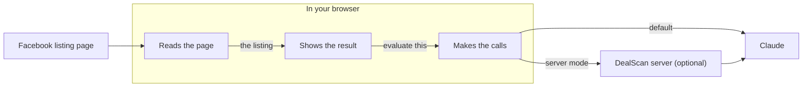
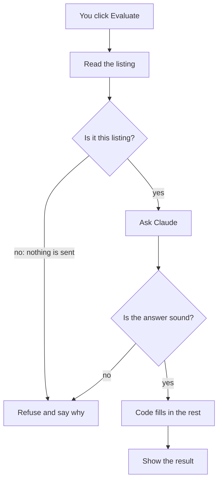
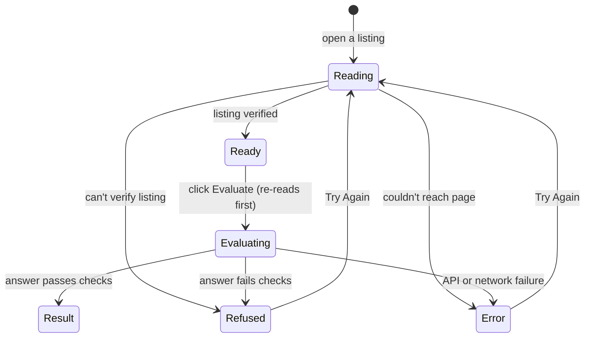
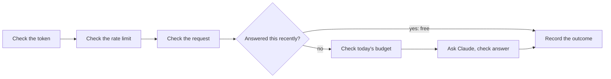
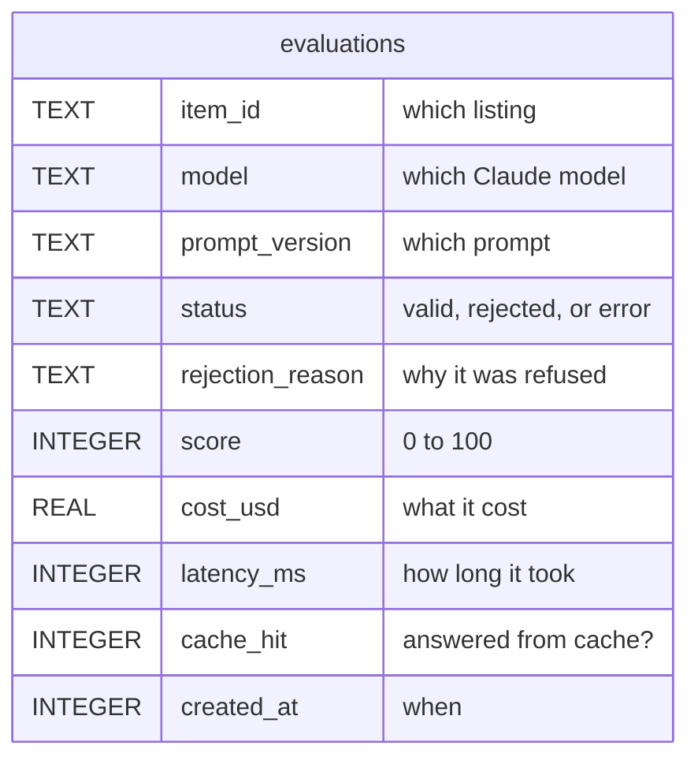

# Architecture

Five simple diagrams, one idea each. Every box is plain English, and the table under each diagram says which file does that job. For the full detail, see [ARCHITECTURE-DETAIL.md](ARCHITECTURE-DETAIL.md).

## 1. The pieces

| Box | File |
|---|---|
| Reads the page | `src/content/` (the scraper and its sources) |
| Shows the result | `src/sidepanel/sidepanel.js` |
| Makes the calls | `src/background/service-worker.js` |
| Claude | `src/shared/anthropic.js` sends the request |
| DealScan server | `server/` |

Three parts of the extension each have one job. One reads the Facebook page, one decides what to trust and shows it, and one makes every network call. Keeping the calls in one place means the API key never enters Facebook's page. The server is optional: by default the extension calls Claude directly with your own key.

## 2. One evaluation

| Box | File |
|---|---|
| Read the listing | `src/content/scraper.js`, asked by `src/sidepanel/sidepanel.js` |
| Is it this listing? | `src/shared/gate.js` |
| Ask Claude | `src/background/service-worker.js`, `src/shared/anthropic.js`, `src/shared/prompt.js` |
| Is the answer sound? | `src/shared/verdict.js` (validation), with the retry in `src/shared/anthropic.js` |
| Code fills in the rest | `src/shared/verdict.js` (`finalizeVerdict`) |
| Show the result | `src/sidepanel/sidepanel.js` |
| Refuse and say why | the panel's refused state, in `src/shared/panel-state.js` |

DealScan refuses instead of guessing at two points:
- **Before anything is sent.** The title and price must be tied to the listing's ID number in the page address.
- **After Claude answers.** An answer that's out of range or contradicts the price gets one retry. If the retry fails too, or Claude declines to answer, DealScan refuses.

Code, not Claude, sets the verdict label, the recommendation, the percent versus the market, and the offer cap.

## 3. What the side panel shows

| State | Name in `src/shared/panel-state.js` |
|---|---|
| Reading | `reading` |
| Ready | `ready` |
| Evaluating | `evaluating` |
| Result | `result` |
| Refused | `rejected` |
| Error | `error` |

The panel is always in exactly one of these states, so it never shows a half-finished answer. "Refused" means DealScan chose not to trust something, and "Error" means something broke. Moving to another listing at any point goes back to Reading, and a late answer for the old listing is thrown away. There's one more state, for pages that aren't a listing, which just asks you to open one.

## 4. The server

| Box | File |
|---|---|
| Check the token | `server/src/app.js`, `server/src/tokens.js` |
| Check the rate limit | `server/src/app.js` |
| Check the request | `server/src/routes/evaluate.js` (the body schema) |
| Answered this recently? | `server/src/routes/evaluate.js`, `server/src/store.js`, `src/shared/cache-key.js` |
| Check today's budget | `server/src/store.js` |
| Ask Claude, check answer | `src/shared/anthropic.js`, `src/shared/verdict.js` |
| Record the outcome | `server/src/store.js`, into SQLite |

Any check can stop the request with a clear error. The cache is checked before the budget because a cached answer costs nothing, so it still works after the day's budget is spent. Once a request passes the first three checks, its outcome is always recorded, whether it was a cache hit, a budget refusal, a refused answer, or a failure.

## 5. What the server records

| Table | File |
|---|---|
| `evaluations` | created by `server/migrations/001_initial.sql`, written by `server/src/store.js` |

Every recorded request is one row, whatever happened to it. That's what makes cost and rejection rates measurable instead of guessed. Other tables hold the listings' text, hashed tokens, and human labels for the evaluation harness. There's no column for seller names or photos.

## More detail

[ARCHITECTURE-DETAIL.md](ARCHITECTURE-DETAIL.md) has the full versions: every message between the parts, the read retries and cache rules, every panel event, the server's error codes, and all five tables.
